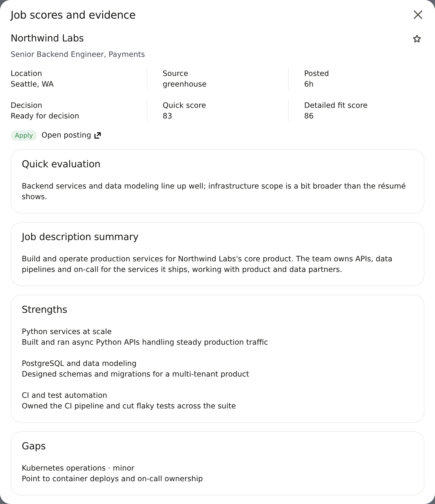
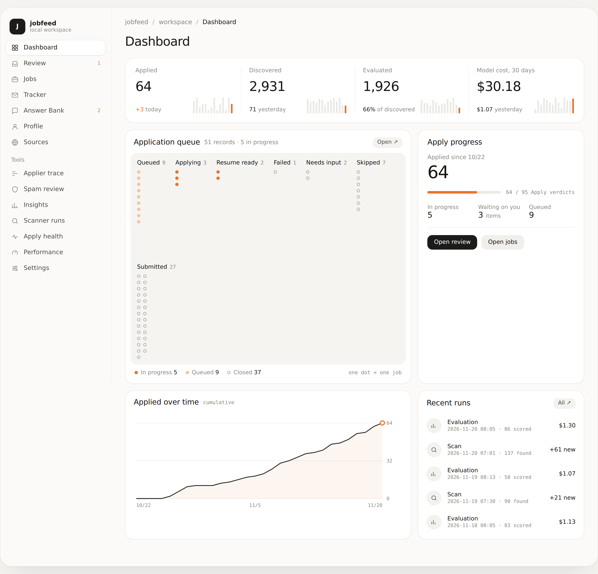

<a id="readme-top"></a>

<div align="center">
  <a href="https://v1ctor2182.github.io/jobfeed/"></a>

  <h1>Jobfeed</h1>

  <p>
    A local-first job search workspace: it finds jobs, scores them against
    your résumé, and applies with Claude Appliers while you keep the final
    say on every Submit.
  </p>

  <p>
    <a href="https://v1ctor2182.github.io/jobfeed/"><strong>Website</strong></a>
    ·
    <strong>English</strong>
    ·
    <a href="README.zh-CN.md">简体中文</a>
  </p>

  <p>
    <a href="https://github.com/V1ctor2182/jobfeed/actions/workflows/ci.yml"></a>
    <a href="LICENSE"></a>
    
    
    
  </p>
</div>

## What it does

**scan → filter → evaluate → apply → track**

| Part | Folder | What it does |
| --- | --- | --- |
| **Jobfeed** | [`jobfeed/`](jobfeed/README.md) | Scans company career pages (Greenhouse, Lever, Ashby, Workday, iCIMS, SmartRecruiters), LinkedIn, Indeed, Jobright and curated lists. Filters noise, scores each job against your résumé with an LLM, and hosts the dashboard. |
| **Applier pipeline** | [`resume-application-pipeline/`](resume-application-pipeline/README.md) | Runs one Claude Code Applier per job in a real Chromium. It picks one of your existing PDF résumés, fills the form, asks you on Discord when it needs a fact, and records the result back in Jobfeed. |





### You stay in control

- **Submit always waits for you** by default: the Dashboard's Submit button,
  or your `submit` reply in the job's Discord thread.
- **Auto submit mode** and **autopilot mode** are off until you turn them on
  yourself. A job with a CAPTCHA, an open question or a Dashboard warning
  still waits for you.
- Setup, tests and opening the dashboard never start a worker, a browser
  session or an application.
- Your résumés, profile, answers, credentials and databases stay on your
  machine and are ignored by Git.

## Quick start: find and score jobs

Needs macOS or Linux and Git.

```sh
git clone https://github.com/V1ctor2182/jobfeed.git
cd jobfeed
./setup.sh
```

`setup.sh` installs the runtime, starts Jobfeed at `http://127.0.0.1:7654`
and opens a guided setup: connect a model, upload your résumé, pick searches
and company boards. Nothing scans until you start it. See the
[Jobfeed guide](jobfeed/README.md) for every step.

### On your own server, with a coding agent

To run Jobfeed on an always-on machine (a VPS, cloud instance or Mac mini),
paste this into any coding agent that can run commands on it: Claude Code or
Codex on the machine itself, or an agent that reaches it over SSH or a
remote-machine tool.

<!-- setup-prompt:start -->
```text
Set up Jobfeed on my server as a background service.
Read https://raw.githubusercontent.com/V1ctor2182/jobfeed/main/docs/server-install.md
and follow it exactly, including how it says to talk to me: short, structured
messages and numbered choices. If you aren't running on my server, ask me how
to reach it. Ask me before using sudo or starting a scan, and test
everything before you hand over.
```
<!-- setup-prompt:end -->

The agent checks the server, installs the dashboard as a service, and walks you
through setup in the chat: AI sign-in, résumé, job profile, searches, when to
scan (every day, or only when you ask) and limits. It offers optional extras
(Handshake and signed-in LinkedIn, a private link for your phone, company
career pages, replies to your applications from Gmail, and Claude Appliers
that apply to the jobs you pick), tests the whole setup,
offers a first scan, and tells you how to open the dashboard. Later, `jobfeed doctor` checks
that everything still works. The steps are in
[`docs/server-install.md`](docs/server-install.md) if you prefer to run them
yourself.

## Add the Applier

The Applier needs a few more things on the same machine:

- The [Claude Code](https://claude.com/claude-code) CLI, signed in.
- Chromium, for the Applier's own browser profile.
- A Discord bot in your own server, so Appliers can ask you questions. Put
  `DISCORD_BOT_TOKEN`, `DISCORD_GUILD_ID` and optionally `DISCORD_CHANNEL_ID`
  and `DISCORD_ALLOWED_USER_IDS` in `~/.config/jobfeed-applier/discord.env`.

Install both projects into one shared environment at the repository root:

```sh
python3.12 -m venv .venv
.venv/bin/python -m pip install -e './jobfeed[dev]' \
  -r resume-application-pipeline/requirements.txt \
  -r resume-application-pipeline/requirements-jobfeed-mcp.txt
```

Then:

1. Open **My Profile** at `/profile` on the dashboard. Fill in your details,
   upload your résumé PDFs and choose which ones Appliers may use.
2. Start the dashboard for the Applier on port 8765, the pipeline's default
   (or set `JOBFEED_API_URL`):

   ```sh
   cd jobfeed && ../.venv/bin/jobfeed serve --port 8765
   ```

3. Read [`resume-application-pipeline/AGENTS.md`](resume-application-pipeline/AGENTS.md)
   and the [batch checklist](docs/claude-cli-cutover-checklist.md), then pick
   jobs on **Apply health** and select **Start with Claude**.

To run the whole loop every day, see [Autopilot](docs/autopilot.md) and the
systemd units in [`deploy/systemd/`](deploy/systemd). The units assume the
checkout lives at `~/jobfeed`; edit the paths if yours does not.

For agent-assisted setup, open this folder in Claude Code or Codex and ask it
to follow [the setup skill](.agents/skills/setup-workspace/SKILL.md).

## Documentation

| Topic | Where |
| --- | --- |
| Jobfeed install, onboarding, settings and CLI | [`jobfeed/README.md`](jobfeed/README.md) |
| Dashboard and My Profile | [`docs/dashboard.md`](docs/dashboard.md) |
| Starting and draining a Claude batch | [`docs/claude-cli-cutover-checklist.md`](docs/claude-cli-cutover-checklist.md) |
| Autopilot from daily scan to apply | [`docs/autopilot.md`](docs/autopilot.md) |
| Adding jobs from a chat by URL | [`docs/jobfeed-mcp.md`](docs/jobfeed-mcp.md) |
| Browser readiness check | [`docs/readiness.md`](docs/readiness.md) |
| Workday accounts | [`docs/workday-accounts.md`](docs/workday-accounts.md) |
| Recruiter sheet sync | [`docs/recruiter-sheet.md`](docs/recruiter-sheet.md) |
| Pipeline internals, answer bank, résumé selection | [`resume-application-pipeline/docs/`](resume-application-pipeline/docs/README.md) |
| Rules for agents working in this repo | [`AGENTS.md`](AGENTS.md), [`CLAUDE.md`](CLAUDE.md) |

## Run the offline tests

From the repository root, with the shared environment above and Node.js:

```sh
cd jobfeed
pnpm --dir web-ui install --frozen-lockfile
HF_HUB_OFFLINE=1 TRANSFORMERS_OFFLINE=1 ../.venv/bin/python -m pytest -q
node --test tests/extension/*.test.cjs
cd ../resume-application-pipeline
../.venv/bin/python tools/create_example_template.py
PYTHONPATH=.:tests ../.venv/bin/python -m pytest tests -q
```

The tests use synthetic data and mock models. They never contact employers.

## Repository layout

```text
jobfeed/                      # Scanning, evaluation, dashboard, Chrome extension
resume-application-pipeline/  # Claude Appliers, batches, Discord bridge, autopilot
docs/                         # Guides that cover both parts
deploy/systemd/               # Optional user services for autopilot
setup.sh                      # Installs and opens Jobfeed
```

Keep `jobfeed/` and `resume-application-pipeline/` side by side. Each finds
the other by that layout.

## Contributing

Issues and focused pull requests are welcome. Describe the user-visible
change, include test evidence, and never commit personal data or credentials.

## Responsible use

Jobfeed is a personal tool that runs on your own computer or server, with your
own accounts. Some sources it can read from or apply through, such as LinkedIn,
Handshake, Jobright and Workday, have terms of service that limit automated
access. You are responsible for following the terms of every site you connect,
and for any effect on your accounts there; use it at your own risk. Keep the
pace low, and don't run Jobfeed as a hosted service for other people.

Jobfeed is not affiliated with, endorsed by or sponsored by any job board,
applicant tracking system or employer it works with. Their names are used only
to describe compatibility.

## License

Released under the [MIT License](LICENSE).

## Acknowledgements

Jobfeed was originally created by [wenqiw777](https://github.com/wenqiw777/jobfeed)
and is published here with their permission.

<p align="right"><a href="#readme-top">Back to top</a></p>
