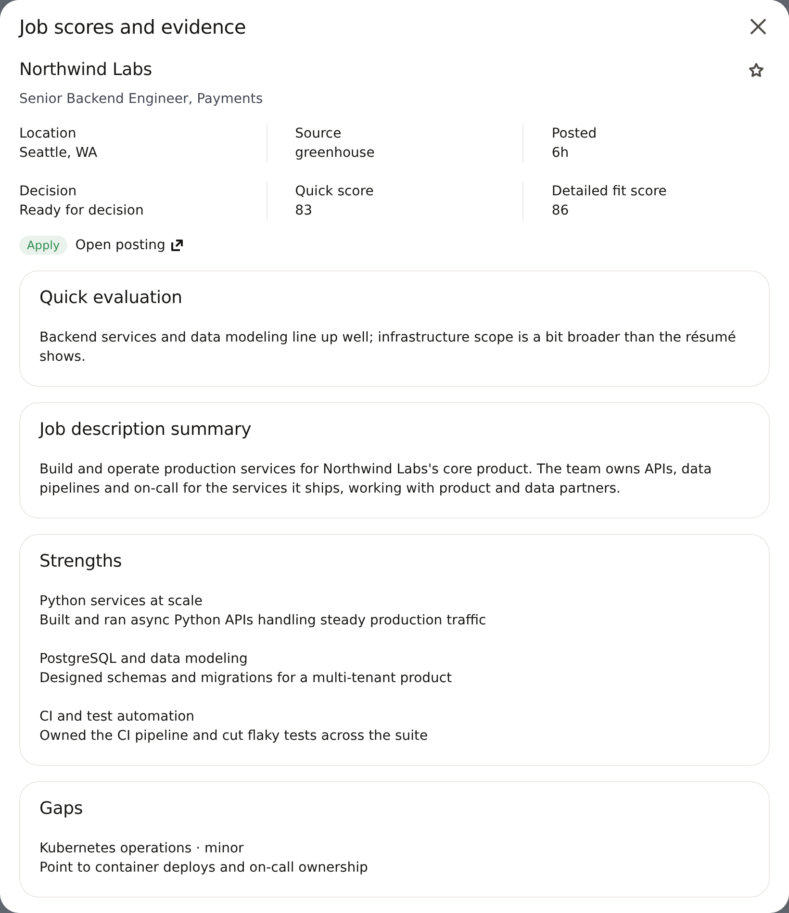
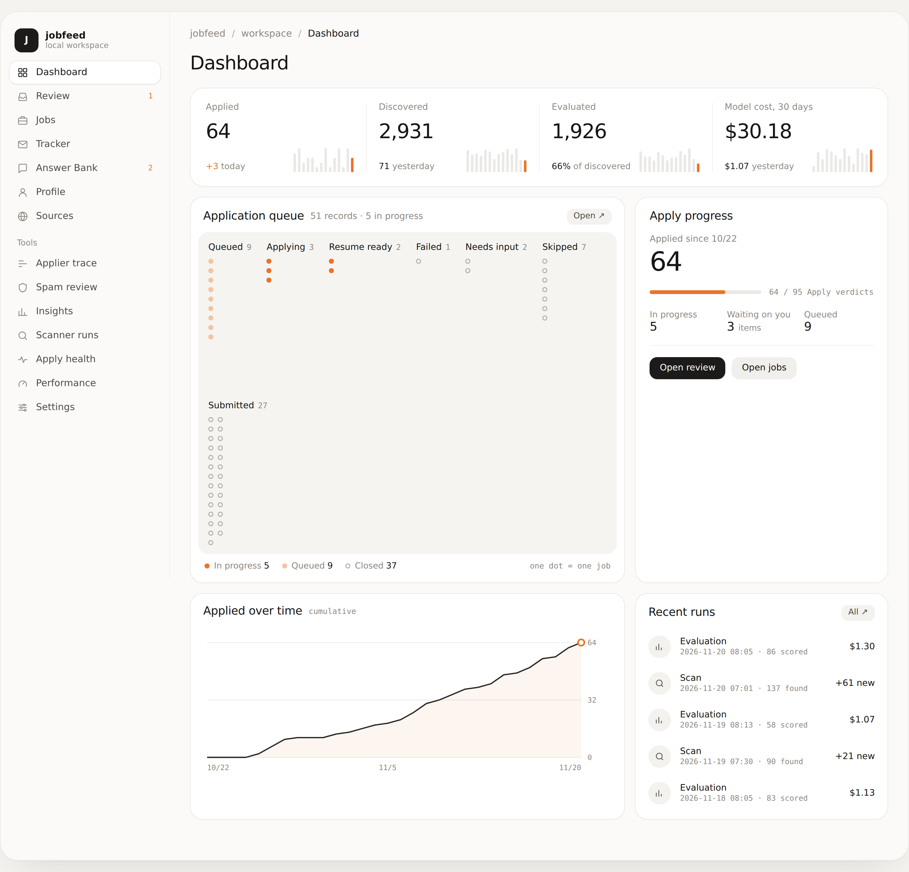

<a id="readme-top"></a>

<div align="center">
  <a href="https://v1ctor2182.github.io/jobfeed/"></a>

  <h1>Jobfeed</h1>

  <p>
    一个本地优先的求职工作台：帮你找岗位、对照简历打分，再用 Claude Applier
    帮你投递，而每一次 Submit 都由你说了算。
  </p>

  <p>
    <a href="https://v1ctor2182.github.io/jobfeed/"><strong>官网</strong></a>
    ·
    <a href="README.md">English</a>
    ·
    <strong>简体中文</strong>
  </p>

  <p>
    <a href="https://github.com/V1ctor2182/jobfeed/actions/workflows/ci.yml"></a>
    <a href="LICENSE"></a>
    
    
    
  </p>
</div>

## 它能做什么

**扫描 → 过滤 → 评估 → 投递 → 跟踪**

| 部分 | 文件夹 | 做什么 |
| --- | --- | --- |
| **Jobfeed** | [`jobfeed/`](jobfeed/README.zh-CN.md) | 扫描公司招聘页（Greenhouse、Lever、Ashby、Workday、iCIMS、SmartRecruiters）、LinkedIn、Indeed、Jobright 和精选岗位列表。过滤噪音，用 LLM 对照你的简历给每个岗位打分，并提供 Dashboard。 |
| **Applier 流水线** | [`resume-application-pipeline/`](resume-application-pipeline/README.md) | 每个岗位启动一个 Claude Code Applier，在真实的 Chromium 里操作。它从你已有的 PDF 简历中挑一份，填写申请表，需要信息时在 Discord 上问你，并把结果记回 Jobfeed。 |





### 一切由你掌控

- 默认情况下，**Submit 一定等你确认**：点 Dashboard 上的 Submit 按钮，
  或者在该岗位的 Discord 线程里回复 `submit`。
- **自动提交模式（auto submit）** 和 **autopilot 模式** 默认关闭，只有你
  自己才能打开。遇到验证码、未回答的问题或 Dashboard 警告的岗位，仍然会等你。
- 安装、运行测试、打开 Dashboard 都不会启动 worker、浏览器会话或任何投递。
- 你的简历、个人资料、答案、凭据和数据库都只留在你自己的电脑上，并且被
  Git 忽略。

## 快速开始：找岗位、打分

需要 macOS 或 Linux，以及 Git。

```sh
git clone https://github.com/V1ctor2182/jobfeed.git
cd jobfeed
./setup.sh
```

`setup.sh` 会安装运行环境，在 `http://127.0.0.1:7654` 启动 Jobfeed，并打开
引导式设置：连接模型、上传简历、选择搜索条件和公司招聘页。你不点开始，就不会
扫描。每一步的详细说明见 [Jobfeed 使用指南](jobfeed/README.zh-CN.md)。

## 加上 Applier（自动投递）

Applier 还需要在同一台电脑上准备这些：

- 已登录的 [Claude Code](https://claude.com/claude-code) CLI。
- Chromium，给 Applier 用一个独立的浏览器配置。
- 在你自己的 Discord 服务器里建一个 bot，让 Applier 能向你提问。把
  `DISCORD_BOT_TOKEN`、`DISCORD_GUILD_ID`，以及可选的 `DISCORD_CHANNEL_ID`
  和 `DISCORD_ALLOWED_USER_IDS` 写进 `~/.config/jobfeed-applier/discord.env`。

在仓库根目录把两个项目装进同一个环境：

```sh
python3.12 -m venv .venv
.venv/bin/python -m pip install -e './jobfeed[dev]' \
  -r resume-application-pipeline/requirements.txt \
  -r resume-application-pipeline/requirements-jobfeed-mcp.txt
```

然后：

1. 在 Dashboard 打开 **My Profile**（`/profile`），填写个人信息，上传简历
   PDF，并选择哪些 PDF 可以给 Applier 使用。
2. 在 8765 端口为 Applier 启动 Dashboard，这是流水线的默认端口（也可以设置
   `JOBFEED_API_URL` 指向别的地址）：

   ```sh
   cd jobfeed && ../.venv/bin/jobfeed serve --port 8765
   ```

3. 阅读 [`resume-application-pipeline/AGENTS.md`](resume-application-pipeline/AGENTS.md)
   和 [批次操作清单](docs/claude-cli-cutover-checklist.md)，然后在
   **Apply health** 页面选好岗位，点 **Start with Claude**。

想每天自动跑完整流程，见 [Autopilot](docs/autopilot.md) 和
[`deploy/systemd/`](deploy/systemd) 里的 systemd 服务。这些服务假设仓库放在
`~/jobfeed`，如果不是，请修改其中的路径。

想让 AI 帮你安装，可以在 Claude Code 或 Codex 里打开这个文件夹，让它按照
[安装 skill](.agents/skills/setup-workspace/SKILL.md) 来做。

## 文档

| 主题 | 位置 |
| --- | --- |
| Jobfeed 安装、首次设置、配置和命令行 | [`jobfeed/README.zh-CN.md`](jobfeed/README.zh-CN.md) |
| Dashboard 和 My Profile | [`docs/dashboard.md`](docs/dashboard.md) |
| 启动和收尾一个 Claude 批次 | [`docs/claude-cli-cutover-checklist.md`](docs/claude-cli-cutover-checklist.md) |
| 从每日扫描到投递的 Autopilot | [`docs/autopilot.md`](docs/autopilot.md) |
| 在聊天里贴 URL 添加岗位 | [`docs/jobfeed-mcp.md`](docs/jobfeed-mcp.md) |
| 浏览器就绪检查 | [`docs/readiness.md`](docs/readiness.md) |
| Workday 账号 | [`docs/workday-accounts.md`](docs/workday-accounts.md) |
| Recruiter sheet 同步 | [`docs/recruiter-sheet.md`](docs/recruiter-sheet.md) |
| 流水线运行原理（中文） | [`resume-application-pipeline/docs/pipeline.md`](resume-application-pipeline/docs/pipeline.md) |
| 答案库、简历选择等流水线文档 | [`resume-application-pipeline/docs/`](resume-application-pipeline/docs/README.md) |
| 在本仓库工作的 AI agent 规则 | [`AGENTS.md`](AGENTS.md)、[`CLAUDE.md`](CLAUDE.md) |

除了标注“中文”的那一篇，这些文档目前是英文。

## 运行离线测试

在仓库根目录，使用上面的共享环境和 Node.js：

```sh
cd jobfeed
pnpm --dir web-ui install --frozen-lockfile
HF_HUB_OFFLINE=1 TRANSFORMERS_OFFLINE=1 ../.venv/bin/python -m pytest -q
node --test tests/extension/*.test.cjs
cd ../resume-application-pipeline
../.venv/bin/python tools/create_example_template.py
PYTHONPATH=.:tests ../.venv/bin/python -m pytest tests -q
```

测试只使用合成数据和模拟模型，不会联系任何雇主。

## 仓库结构

```text
jobfeed/                      # 扫描、评估、Dashboard、Chrome 扩展
resume-application-pipeline/  # Claude Applier、批次、Discord 桥、autopilot
docs/                         # 覆盖两部分的指南
deploy/systemd/               # 可选的 autopilot 用户服务
setup.sh                      # 安装并打开 Jobfeed
```

请让 `jobfeed/` 和 `resume-application-pipeline/` 保持并排，它们靠这个结构
互相找到对方。

## 参与贡献

欢迎提交 issue 和聚焦的 pull request。请说明用户可见的变化，附上测试证据，
并且不要提交任何个人数据或凭据。

## 使用须知

Jobfeed 是一个个人工具，运行在你自己的电脑或服务器上，使用你自己的账号。它可以读取或
用来投递的部分来源（例如 LinkedIn、Handshake、Jobright 和 Workday）在服务条款中限制
自动化访问。你需要自行遵守所连接的每个网站的条款，并为你在这些网站上的账号承担后果；
使用风险自负。请保持较低的访问频率，不要把 Jobfeed 作为托管服务提供给他人使用。

Jobfeed 与它所对接的任何招聘网站、招聘系统（ATS）或雇主均无关联，也未获得其认可或
赞助。文中提到它们的名称只是为了说明兼容性。

## 许可证

以 [MIT 许可证](LICENSE) 发布。

## 致谢

Jobfeed 最初由 [wenqiw777](https://github.com/wenqiw777/jobfeed) 创建，经其
许可在此发布。

<p align="right"><a href="#readme-top">回到顶部</a></p>
