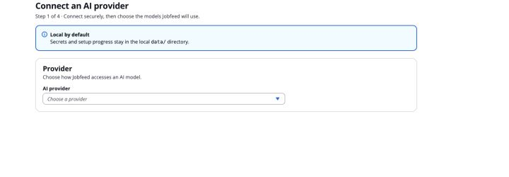
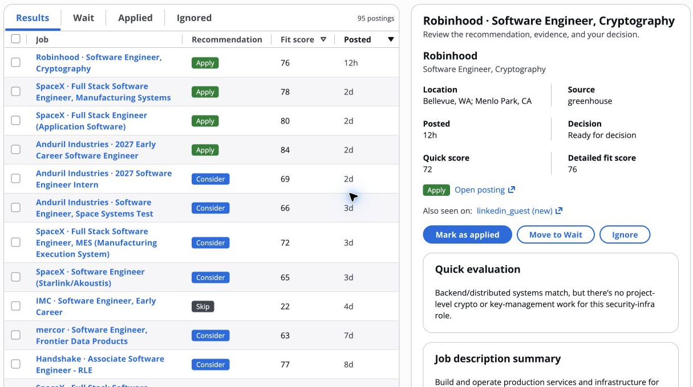
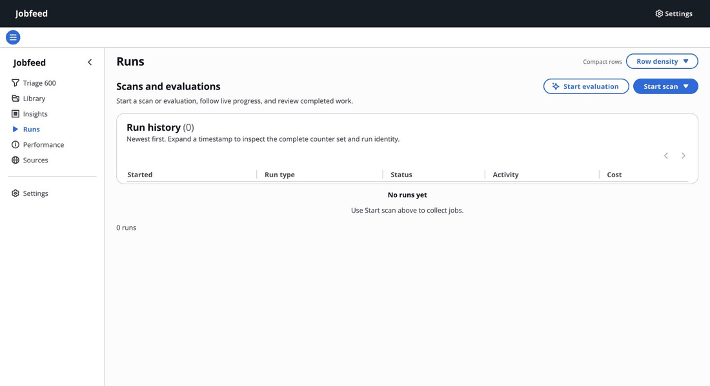
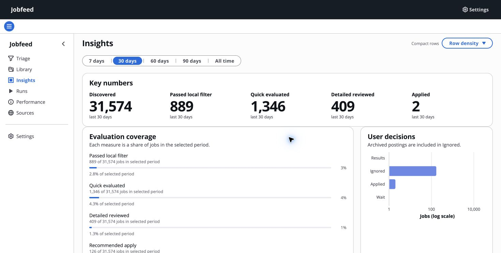
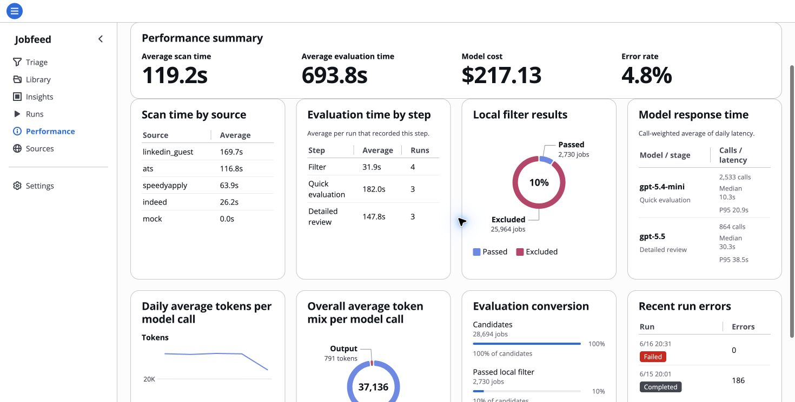

<a id="readme-top"></a>

<div align="center">
  

  <h1>Jobfeed</h1>

  <p>
    一个本地优先的求职工作台：帮你找岗位、对照简历评估匹配度，
    并把每一个决定都集中在一个清爽的界面里。
  </p>

  <p>
    <a href="README.md">English</a>
    ·
    <strong>简体中文</strong>
  </p>

  <p>
    <a href="https://github.com/V1ctor2182/jobfeed/actions/workflows/ci.yml"></a>
    <a href="../LICENSE"></a>
    
    
    
  </p>

  <p>
    <a href="#功能演示"><strong>演示</strong></a>
    ·
    <a href="#快速开始">安装</a>
    ·
    <a href="#首次设置">首次设置</a>
    ·
    <a href="#工作区设置">设置</a>
    ·
    <a href="#日常使用">使用</a>
    ·
    <a href="#开发">开发</a>
    ·
    <a href="https://github.com/V1ctor2182/jobfeed/issues">报告问题</a>
  </p>
</div>

## 为什么选择 Jobfeed

Jobfeed 把零散的求职过程整合成一条本地工作流：

- 第一次扫描之前，先完成引导式设置：连接模型、确认从简历生成的求职画像、
  选择搜索条件、验证公司招聘页，并检查各项上限和预估的模型用量。
- 扫描公司招聘页、LinkedIn Guest、Indeed、a16z speedrun 人才网络和精选岗位
  列表。LinkedIn Guest 在发现岗位之后，会按节奏分批抓取完整的 JD。
  可选的 `ats-search` 通过网页搜索发现新的公司招聘页，并且只有在该公司自己的
  ATS API 列出匹配岗位后才会加入，默认关闭。`ats-discovery` 同样默认关闭，
  它会从 VC 投资组合的招聘页和 Hacker News 招聘帖中，把招聘页托管在 Ashby、
  Greenhouse 或 Lever 上的公司加进来。
- 每个来源可以单独设置数量上限，结果去重之后，再决定要评估多少个不重复的岗位。
- 在调用模型之前，先用确定性规则和可选的本地 ML 过滤器排除不相关的岗位。
- 先做快速评估（Quick），再做详细的简历与 JD 证据对照（Detailed）。
- 查看结果后记录一个决定：**Wait**（等待）、**Applied**（已投递）或
  **Ignored**（忽略）。
- 实时查看扫描和评估计数的变化。
- 配置和岗位数据都保存在仓库本地的 SQLite 数据库里。

**流程：** 扫描岗位 → 过滤噪音 → 评估简历匹配度 → 决定下一步。

普通用户不需要 Docker、PostgreSQL，也不需要构建前端。

## 功能演示

### 一条命令完成引导式安装

在终端里运行 `./setup.sh`。它会安装本地运行环境、启动 Jobfeed，并自动打开
真正的图形界面。全新的工作区会进入模型提供方的引导步骤；已有的工作区会直接
打开 Jobfeed。



### 对照每个 JD 查看简历匹配度

打开一个岗位，可以对比快速评分、详细匹配评分、证据和推荐操作，再记录你的决定。



### 实时评估进度

工作进行时，**Runs** 页面会实时显示每个阶段和计数。这段录屏使用的是匿名的
确定性演示岗位和模拟的模型回复。



### 数据洞察（Insights）

查看所选时间范围内的评估覆盖情况和你做出的决定。



### 性能（Performance）

在同一个视图里对比扫描耗时、评估各步骤、模型延迟、token 用量、转化率和最近
运行中的错误。



## 快速开始

### 前置条件

- macOS 或 Linux
- Git
- 只有在没装 [`uv`](https://docs.astral.sh/uv/) 时才需要 `curl`

### 安装并打开图形界面

```sh
git clone https://github.com/V1ctor2182/jobfeed.git
cd jobfeed
./setup.sh
```

`setup.sh` 会在需要时安装 `uv`，创建仓库本地的 Python 运行环境，初始化
`data/jobfeed.sqlite`，在 `http://127.0.0.1:7654` 启动 Jobfeed 并打开设置
页面。它还会为当前用户安装一个 `jobfeed` 终端启动命令。

首次设置完成后，打开一个新终端并运行：

```sh
jobfeed
```

不带参数时，`jobfeed` 会启动或复用本地服务并打开图形界面。重复运行
`./setup.sh` 也是安全的。

## 首次设置

全新克隆的仓库会打开 `/setup`。设置过程可以中断后继续，并且**不会自动开始任何
扫描**。

1. **连接 AI 提供方。** 可选 OpenAI API、Anthropic API、Azure OpenAI、已登录的
   Codex CLI 或已登录的 Claude Code CLI。测试连接后，分别选择 Quick 和 Detailed
   两个模型。使用 Azure 时，填写当前资源的 `/openai/v1` 端点和已有的部署别名，
   把每个别名对应到它的基础模型，并确认输入、输出和可选的缓存输入价格。这些
   确认过的价格会用来计算每日美元上限。
2. **确认求职画像。** 上传 PDF、DOCX、Markdown 或纯文本格式的简历。先预览在
   本地提取出的文字，再由你明确发送去分析，确认前可以修改每一项建议的偏好。
3. **选择岗位搜索。** Jobfeed 会根据确认后的画像，生成覆盖全美国的成对
   LinkedIn Guest 和 Indeed 搜索。每个选中的岗位方向会生成两条来源查询，也可以
   添加自定义职位名称，不用手动拼任何 URL。默认的新鲜度窗口是：LinkedIn 和其他
   来源精确为 36 小时，Indeed 保留完整的两天候选窗口。只要来源提供真实发布时间，
   两条规则都以它为准。
4. **选择公司招聘页。** 审阅根据画像推荐、且 Greenhouse、Ashby 或 Lever 招聘页
   已验证的公司；或者从公开的应届生和实习岗位列表中导入去重后的完整目录；也可以
   手动添加公司名、slug 或招聘页 URL。页面会准确显示新增了多少家公司。
5. **检查运行计划。** 设置不重复岗位的评估上限、每个来源的扫描总数、硬性过滤
   条件、调用上限、并发数，以及从 Quick 进入 Detailed 的分数阈值。用量估算假设
   每个选中的岗位都会做一次 Quick 评估，其中约 30% 会进入 Detailed 审阅。使用
   Codex 或 Claude CLI 时，可选的校准步骤会从最多 30 条结果中挑一个长度接近样本
   平均值的真实 Indeed JD，实际测量一次 Quick 和一次 Detailed 调用。

点击 **Finish setup** 保存当前配置。准备好之后，打开 **Runs** 开始第一次扫描或
评估。

## 工作区设置

完成引导后，在图形界面里打开 **Settings** 管理以下内容：

- **Résumé（简历）**：选择作为评估证据的 Markdown 或纯文本文件。
- **Models（模型）**：使用已登录的 Codex 或 Claude 应用、兼容 OpenAI 的 API，
  或者带有逐个部署确认价格的 Azure OpenAI 部署别名。
- **Sources（来源）**：启用数据源，编辑搜索 URL 和跟踪的 ATS 公司，并为每个
  来源（而不是每条搜索 URL）设置一个岗位总数上限。
- **Filters（过滤）**：在评估之前限制地点、公司和发布时间。
- **Evaluation（评估）**：设置不重复岗位数、每日模型调用次数、API 费用和并发
  上限。ATS 扫描只保留从你确认的搜索条件推导出的职位名称，之后才占用公司招聘页
  的数量上限。

保存的设置无需重启 Jobfeed 即可生效。

仓库自带 [`resume.example.md`](resume.example.md) 和
[`preamble_personal.example.md`](preamble_personal.example.md) 作为可选的起点。
你真实的简历、本地配置和 SQLite 数据都已被 gitignore。

### 个人岗位过滤器

Quick 评估的结果会用来训练可选的本地相关性过滤器。前 100 个标注用于建立基线，
接下来的 200 个只打分不过滤，再接下来的 200 个在新岗位上验证候选阈值。在这个
学习和影子运行阶段，Jobfeed 会让所有岗位保持可见。

当过滤器通过召回率和拒绝率检查后，Jobfeed 会显示 **Your personal job filter is
ready**，并附上实测证据。它永远不会自动开启过滤器。你审阅并开启之后，被拒绝的
岗位仍然可以在 Library 中找回，一小部分探索样本仍会进入 Quick 评估；如果最近的
召回率低于 90%，过滤会自动暂停。

## 日常使用

图形界面是主要入口。同一个运行环境也提供一个精简的命令行：

| 命令 | 作用 |
| --- | --- |
| `jobfeed` | 在前台运行本地图形界面，`Ctrl+C` 停止 |
| `jobfeed dev` | 以热重载方式同时运行 API 和 Vite，`Ctrl+C` 一起停止 |
| `jobfeed scan --source mock` | 运行一次离线冒烟扫描 |
| `jobfeed scan` | 扫描所有已启用的来源 |
| `jobfeed enrich-linkedin-guest` | 继续一轮按节奏进行的 LinkedIn Guest JD 补全 |
| `jobfeed evaluate` | 用配置的简历评估符合条件的岗位 |
| `jobfeed digest` | 生成当前的摘要 |
| `jobfeed --help` | 列出所有命令和选项 |

如果想明确使用仓库本地的命令，可以用 `./bin/jobfeed ...`。两个入口使用同一份
配置和同一个 SQLite 数据库。

默认情况下，包含 LinkedIn Guest 的扫描会在发现岗位后自动运行一轮有上限、按节奏
进行的 JD 补全。单独的补全命令用于继续额外的或被中断的工作。

## 数据与隐私

- 运行数据默认保存在 `data/jobfeed.sqlite`。
- 图形界面中的设置会写入 `config.toml`。
- 引导过程的草稿保存在本地的 `data/onboarding*.json` 文件里，上传的简历保存在
  `data/resumes/`，模型提供方的密钥保存在 `data/secrets.toml`，文件权限为私有，
  并且在图形界面中只能写入、不能读取。
- Jobfeed 默认只把图形界面绑定到本机回环地址（`127.0.0.1`）。
- 你的简历、配置、数据库、日志和生成的摘要都不会被提交。
- 只有在你点击 **Analyze résumé** 之后，简历文字才会发送给所选的模型提供方。
  除此之外，只有你启用的来源和模型后端才会产生网络访问。

想要一份可携带的工作区副本时，备份这个 SQLite 文件即可。

## 技术栈

- [Python](https://www.python.org/) 和 [FastAPI](https://fastapi.tiangolo.com/)
- [SQLite](https://www.sqlite.org/) 搭配 [aiosqlite](https://aiosqlite.omnilib.dev/)
- [React](https://react.dev/) 和 [Cloudscape Design System](https://cloudscape.design/)
- [TanStack Query](https://tanstack.com/query/latest) 和 [Vite](https://vite.dev/)
- 命令行使用 [Click](https://click.palletsprojects.com/)

## 开发

最终用户拿到的是预先构建好的图形界面，不需要 Node.js。贡献者可以这样安装完整的
开发工具链：

```sh
uv sync --extra dev --python 3.12
make quality
```

带热重载的前端开发：

```sh
pnpm --dir web-ui install --frozen-lockfile
jobfeed dev
```

这样 API 和 Vite 开发服务器会在同一个前台会话中运行，按一次 `Ctrl+C` 即可同时
停止。

提交改动之前请运行 `make quality`。涉及浏览器界面的改动，还应该在真实的图形界面
中实际操作一遍。项目的编码和验证规则见
[`docs/engineering-standards.md`](docs/engineering-standards.md)。

### 可选的 ML 模型检查

真实的本地 ML 过滤器检查特意和默认的快速测试分开，因为它第一次运行时需要下载
embedding 模型：

```sh
jobfeed ml-gate fetch
pytest -m mlmodel
```

## 项目结构

```text
src/jobfeed/
├── domain/      # 纯业务规则和模型
├── ports/       # 异步能力接口
├── services/    # 工作流编排
├── adapters/    # SQLite、数据来源、模型和外部 I/O
└── web/         # FastAPI 路由和图形界面托管
web-ui/          # React + Cloudscape 界面
tests/           # 单元、契约、集成和浏览器测试
```

## 参与贡献

欢迎提交 issue 和聚焦的 pull request。请说明用户可见的行为变化，附上相关的测试
证据，并且不要提交本地数据或凭据。

## 许可证

Jobfeed 以 [MIT 许可证](../LICENSE) 发布。

## 致谢

Jobfeed 最初由 [wenqiw777](https://github.com/wenqiw777/jobfeed) 创建，经其
许可在此发布。

本 README 的结构参考了
[Best-README-Template](https://github.com/othneildrew/Best-README-Template)。
以演示为先的简洁呈现方式受到 [holehe](https://github.com/megadose/holehe) 和
[awesome-readme](https://github.com/matiassingers/awesome-readme) 中精选示例的启发。

<p align="right"><a href="#readme-top">回到顶部</a></p>
